<p align="center">
  <a href="https://gitbob.app/">
    
  </a>
</p>

<h1 align="center">GitBob</h1>

<p align="center">
  <b>A free desktop Git client with a beautiful commit graph and everything you need every day.</b><br>
  See your whole history at a glance, stage and commit with real diffs, juggle branches,<br>
  and sync with your remotes without memorizing a single command. Your Git, just friendlier.
</p>

<p align="center">
  
  
  
  <a href="https://github.com/szabto/gitbob/releases/latest"></a>
  
  
</p>

<p align="center">
  <a href="https://gitbob.app/"><b>gitbob.app</b></a> ·
  <a href="#get-started">Get started</a> ·
  <a href="#how-to-use-gitbob">How to use it</a> ·
  <a href="#features">Features</a> ·
  <a href="#keyboard-shortcuts">Shortcuts</a> ·
  <a href="#faq">FAQ</a> ·
  <a href="#for-developers">For developers</a>
</p>

<br>

<p align="center">
  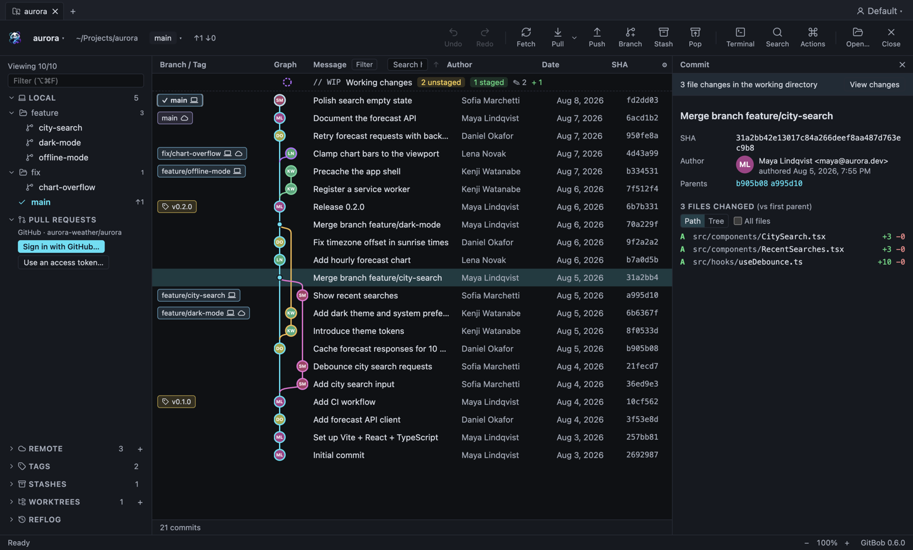
  <br>
  <sub>The commit graph of a small project: feature branches, merges, tags, remote branches and uncommitted work, with a merge commit selected.</sub>
</p>

> [!NOTE]
> **GitBob is free.** No account, no sign-up, no telemetry. It works offline and talks only to the Git remotes you use.

<br>

<table>
  <tr>
    <td width="25%" valign="top">
      <h3>🌈 See everything</h3>
      Every branch, merge and tag drawn as a clear, colorful graph. Click any commit to see who changed what, and why.
    </td>
    <td width="25%" valign="top">
      <h3>✍️ Commit with confidence</h3>
      Review each change as a diff, pick exactly which files go in, write a message and commit. Fix the last commit with Amend.
    </td>
    <td width="25%" valign="top">
      <h3>🌿 Branch without fear</h3>
      Create, switch, rename and delete branches with a right-click. Fetch, pull and push with one button each.
    </td>
    <td width="25%" valign="top">
      <h3>🛟 Hard to break things</h3>
      Risky actions always ask first. Discarded new files go to your Trash, not into the void. Force pushes use <code>--force-with-lease</code>.
    </td>
  </tr>
</table>

<br>

## Get started

> [!IMPORTANT]
> GitBob is in **early alpha**. It's careful with your work, but keep your usual backups and pushes.

**1. Install [Git](https://git-scm.com/downloads)** if you don't have it. GitBob uses the Git on your computer for everything.

**2. Download GitBob** (latest release):

| Platform | Download |
|---|---|
| macOS, Apple Silicon (M1 and newer) | [GitBob-mac-arm64.dmg](https://github.com/szabto/gitbob/releases/latest/download/GitBob-mac-arm64.dmg) |
| macOS, Intel | [GitBob-mac-x64.dmg](https://github.com/szabto/gitbob/releases/latest/download/GitBob-mac-x64.dmg) |
| Windows 10/11, 64-bit | [GitBob-win-x64.exe](https://github.com/szabto/gitbob/releases/latest/download/GitBob-win-x64.exe) |
| Linux, x64 | [AppImage](https://github.com/szabto/gitbob/releases/latest/download/GitBob-linux-x86_64.AppImage) · [.deb](https://github.com/szabto/gitbob/releases/latest/download/GitBob-linux-amd64.deb) |

These builds aren't signed with a developer certificate yet. **macOS:** open GitBob the first time with right-click → **Open**. **Windows:** if SmartScreen appears, click **More info** → **Run anyway**.

**3. Open a project:** click **Open Repository…**, **Clone…** or **New repository…**. That's it.

<details>
<summary>Run from source instead</summary>

You need Git and [Node.js](https://nodejs.org/) 22 or newer.

```sh
git clone https://github.com/szabto/gitbob.git
cd gitbob
npm install
npm run dev
```

</details>

<br>

## How to use GitBob

New to Git, or just new to GitBob? This is the whole tour.

### 1. Open, clone or create a project

- **Open Repository…** (<kbd>⌘O</kbd> / <kbd>Ctrl+O</kbd>) opens a project folder that already uses Git.
- **Clone…** (<kbd>⇧⌘O</kbd>) downloads a project from a URL such as `https://github.com/owner/repo.git`; you pick where it goes, and GitBob shows the progress.
- **New repository…** starts version control in a folder.

Every project opens in its own **tab**, so you can keep several open at once. GitBob remembers your tabs and recent projects for next time.

<p align="center">
  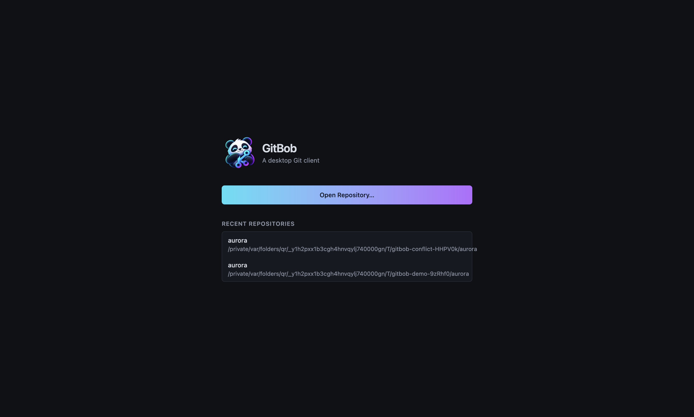
</p>

### 2. Read the graph

Each row is a **commit**, a saved snapshot of your project, newest at the top.

- **Colored lines** are lines of work. When a line splits off, someone started a branch; when two lines join, a branch was merged.
- **Labels** next to a message show where branches point: <code>main</code> is a local branch, <code>origin/main</code> is the same branch on the server, and 🏷 marks a tag such as a release.
- The **ringed dot** is where you are right now (HEAD). The ● in the left sidebar marks your current branch, and arrows like ↑1 ↓2 tell you how many commits you are ahead of or behind the server.
- Click a commit to see its full message, author, parents and changed files. Click a file to see exactly what changed.

Too busy to read? Click **Filter** above the commit list to show only certain branches, one author's commits, or the history of a file or folder.

Looking for something? Press <kbd>⌘F</kbd> / <kbd>Ctrl+F</kbd> and type part of a message, an author's name or a commit id. GitBob searches the **entire** history, highlights the matches and jumps between them with <kbd>Enter</kbd>.

### 3. Save your work (commit)

When you change files, a **// WIP** row appears at the top of the graph. Click it.

<p align="center">
  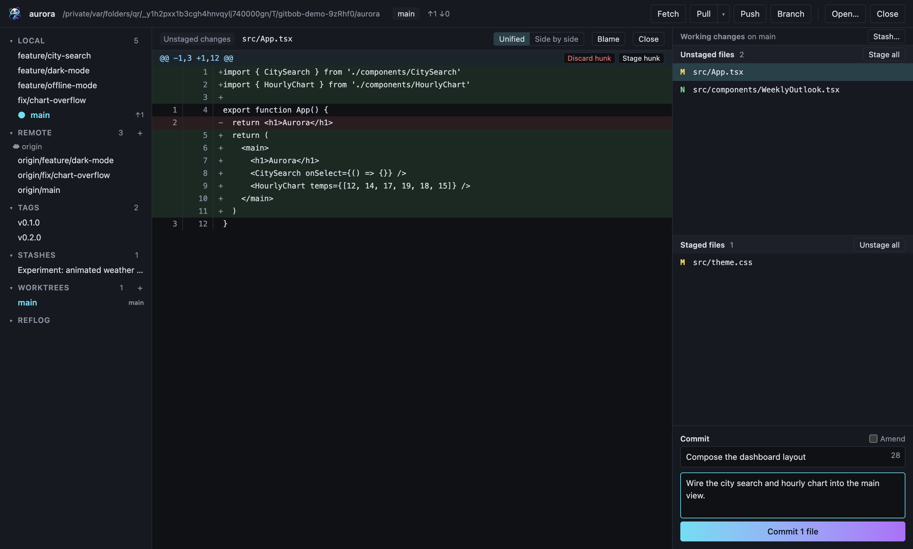
  <br>
  <sub>Reviewing a change before committing it. Green lines were added, red lines removed.</sub>
</p>

1. **Look at your changes.** Click a file to see its diff in the middle.
2. **Stage what belongs together.** Hover a file and click **Stage** (or **Stage all**). Staged files are what goes into the next commit.
3. **Describe it.** Type a short summary (and optionally a longer description).
4. Click **Commit**. Done. Made a typo? Tick **Amend** to change the last commit instead.

GitBob keeps an unfinished message for each repository, fills in your `commit.template` if you have one, and points out summaries that are too long. In projects that use Conventional Commits a **type** picker appears, and **Add co-author…** adds a `Co-authored-by:` line for anyone who recently committed.

Spotted a typo while reviewing? Click **Edit** above the diff to fix the file right there, then **Save** or **Save and stage**. If another program changed the file in the meantime, GitBob won't overwrite it.

Want only part of a file in the commit? Every block of changes (a *hunk*) has its own **Stage hunk** button, and you can click individual green or red lines to select them and press **Stage 2 lines**. The same works backwards for **Unstage** and **Discard**. Prefer reading changes next to each other? Switch the diff to **Side by side** for a syntax-highlighted, two-column view.

Changed your mind about a file? **Discard** throws away its unstaged edits after asking you first. Staged changes are kept, and brand-new files are moved to the Trash so you can still get them back.

### 4. Work with branches

<p align="center">
  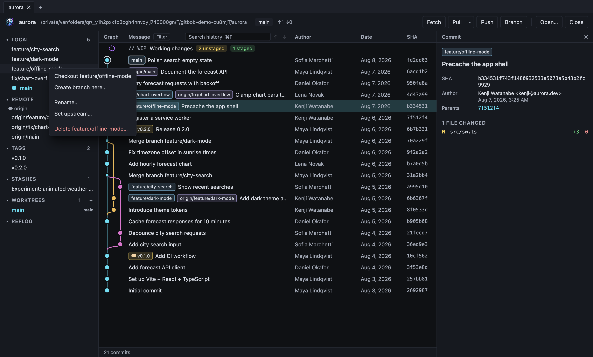
</p>

- **New branch:** click **Branch** in the toolbar (it starts from where you are), or right-click any commit → **Create branch here…**
- **Folders:** branches named like `feature/login` are grouped into collapsible folders (`feature › login`), and remote branches sit under their remote (`origin › feature › login`).
- **Switch branch:** double-click it in the sidebar. Double-clicking a remote branch such as `origin/feature` creates a local copy that tracks it.
- **Merge or rebase:** right-click a branch → **Merge … into main** or **Rebase main onto …**, or just drag it: drop a branch on your current branch (in the sidebar or on its label in the graph) and pick merge or rebase. Drag a commit onto your current branch to cherry-pick it.
- **Rename, delete, set upstream:** right-click the branch. GitBob refuses to delete a branch whose work isn't merged anywhere unless you confirm twice.
- **Look at an old version:** right-click a commit → **Checkout this commit**.

GitBob never overwrites your uncommitted changes when switching. If Git would have to, it tells you instead.

<p align="center">
  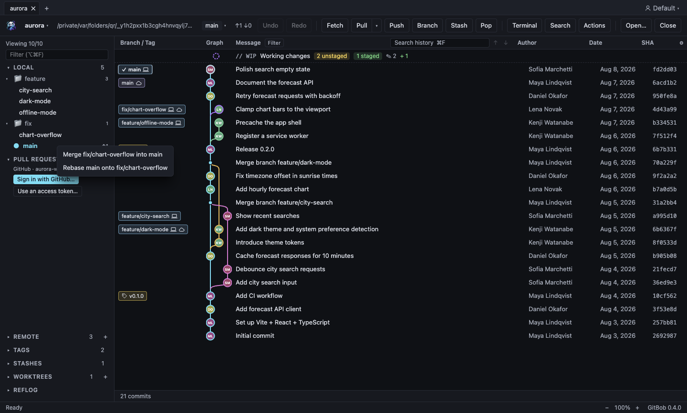
  <br>
  <sub>Drop a branch on your current branch to merge or rebase it.</sub>
</p>

### 5. Sync with the server

| Button | What it does |
|---|---|
| **Fetch** | Downloads what's new on the server without touching your files. Remote labels move; your branch stays put. |
| **Pull** | Brings the server's new commits into your current branch. By default it only fast-forwards; use the ▾ menu to merge or rebase when histories have diverged. |
| **Push** | Uploads your commits. A brand-new branch is published and linked to the server automatically. |

If the server needs a username and password (or token), GitBob asks for it in a dialog; tick **Remember in my system keychain** and it's saved securely once the sign-in works. SSH keys with a passphrase and first connections to a new server are handled in dialogs too (you see the server's fingerprint before trusting it). Long operations show their progress and can be cancelled.

### 6. Pull requests and CI

Working with GitHub, GitLab, Bitbucket or Azure DevOps? Open **Pull requests** in the sidebar and click **Connect**. GitBob opens the page where you create a personal access token; paste it, and GitBob stores it encrypted by your operating system. Once an account is connected, **Clone…** lists your repositories from it: start typing to search, pick one, and tick **Use SSH** if you prefer SSH URLs. Then you see the open pull requests of the repository, whether the selected commit's CI checks passed, and you can right-click a pushed branch → **Create pull request…**.

Click a pull request to open it inside GitBob: read the description and comments, see who approved and whether CI passed, and switch to **Files** to read every change (GitBob downloads the pull request's commits, so diffs work offline afterwards). Hover a line in a file's diff and click **+** to comment on that line; existing review comments appear right under their lines. Leave a general comment, **Approve** or **Request changes**, and when it's ready pick merge, squash or rebase and press **Merge pull request**. GitBob asks first, and refuses if someone pushed new commits since you looked.

On GitHub you can also **Sign in with GitHub** instead of pasting a token: GitBob shows a short code, opens github.com in your browser, and you approve it there.

<p align="center">
  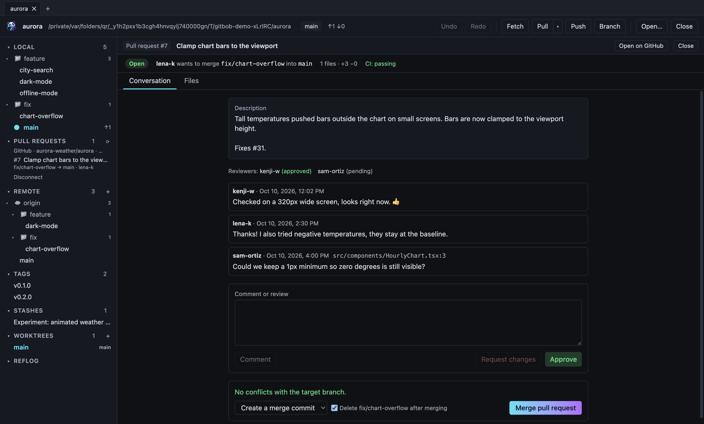
  <br>
  <sub>Review a pull request without leaving GitBob.</sub>
</p>

<p align="center">
  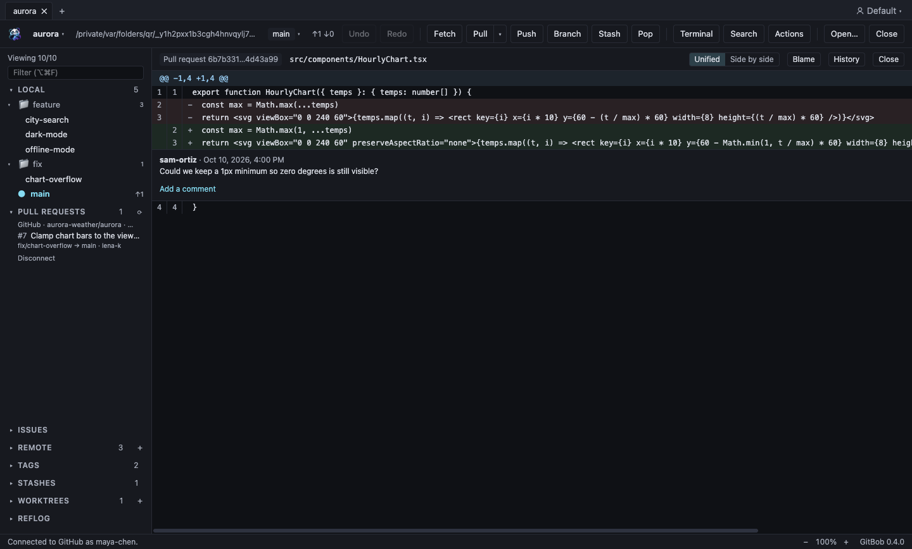
  <br>
  <sub>Line comments sit right under the lines they talk about.</sub>
</p>

<p align="center">
  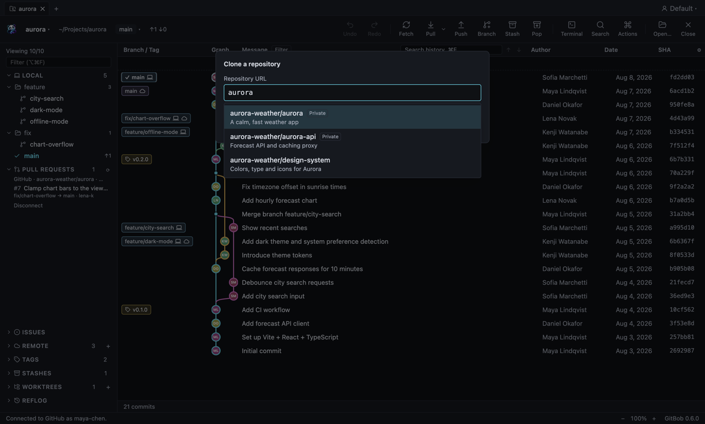
  <br>
  <sub>Clone straight from a list of your repositories.</sub>
</p>

### 7. Undo, park and reuse work

Right-click any commit for the time-travel tools:

<p align="center">
  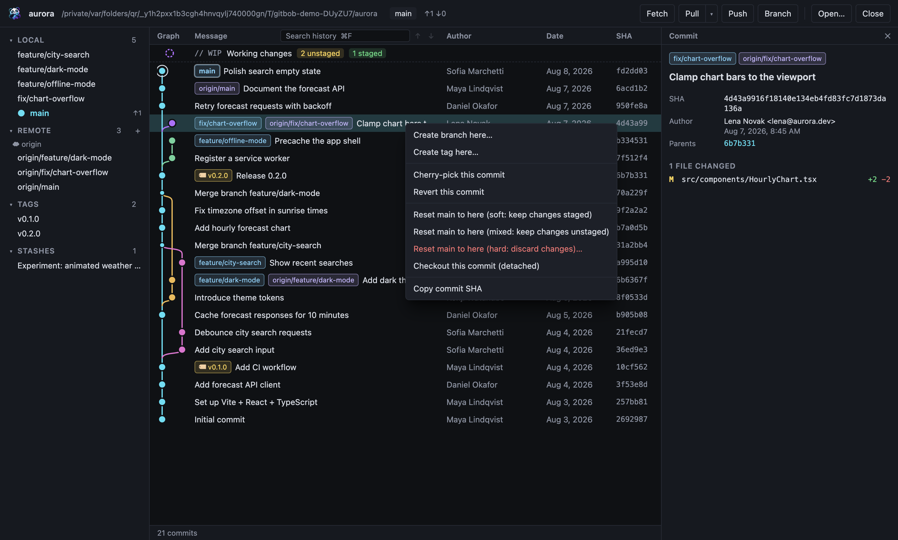
</p>

- **Cherry-pick** copies that commit onto your current branch.
- **Revert** adds a new commit that undoes it (safe for shared branches).
- **Reset** moves your branch back to that commit. *Soft* keeps the changes staged, *mixed* keeps them as unstaged edits, *hard* throws them away. Before a hard reset GitBob asks you, and saves your uncommitted work as a backup stash so it can come back.
- **Stash** parks unfinished work: **Stash…** in Working changes, or right-click a single file to stash just that one. Click a stash to see its files, **Pop** or **Apply** it, bring back one file with **Apply file**, or turn it into a new branch with **Branch…**.
- **Create tag** marks a release, with an optional message. Push or delete tags from the sidebar.
- **Undo / Redo** in the toolbar (⌥⌘Z / ⇧⌥⌘Z) take back the last commit, amend, checkout, branch or tag change, reset, cherry-pick, revert, pull or rebase you did in GitBob. Undo never overwrites uncommitted work, and refuses if the repository changed in the meantime.
- **File history** (in any file's diff, or right-click a file in a commit) lists every commit that changed the file, following renames, with each commit's change.

<p align="center">
  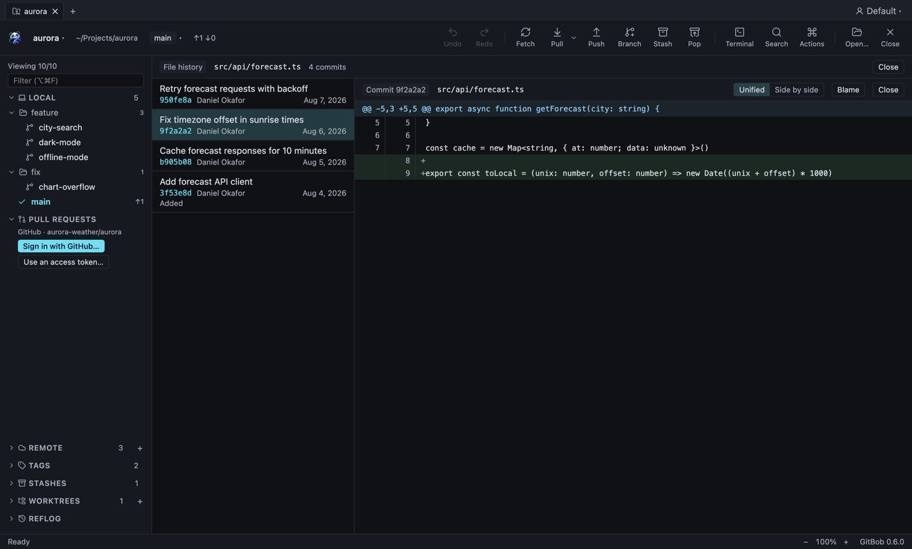
</p>

- **Blame** (in any file's diff) shows who last changed each line and links to that commit.

Want to tidy up before sharing? Right-click the commit *before* the ones you want to change and choose **Interactive rebase onto here**. Reorder commits with the arrows, and for each one pick **Reword** (new message), **Squash** or **Fixup** (fold into the commit above) or **Drop**.

<p align="center">
  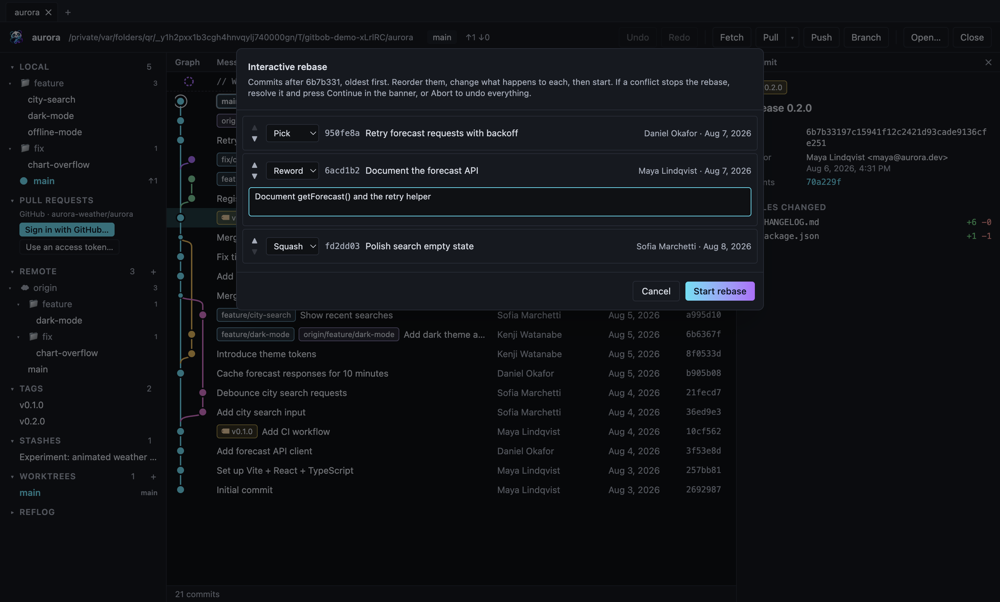
</p>

Lost something after a reset or rebase? Open **Reflog** in the sidebar: it lists everywhere your HEAD has been. Right-click an entry to create a branch there and get the work back.

Need to switch tasks with half-finished work? Click **Stash…** in Working changes. Your edits are put aside and the working tree is clean. They wait under **Stashes** in the sidebar, where **Pop** brings them back.

<p align="center">
  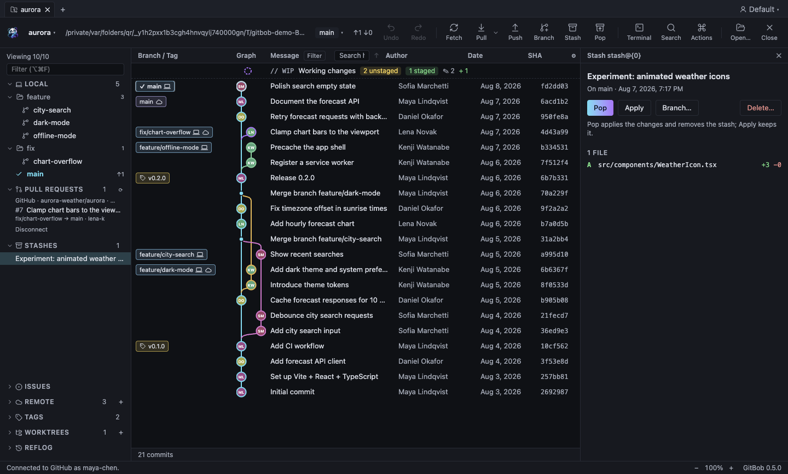
</p>

If a merge, rebase, cherry-pick or revert stops because of a conflict, a yellow banner tells you how many files need attention and offers **Continue**, **Skip** and **Abort**. Click a conflicted file in Working changes to open the conflict editor: your version and theirs side by side on top, the result below. Pick **Ours**, **Theirs** or **Both** for each conflict (or edit the result yourself), then **Save and mark resolved** and press **Continue**.

Images and other binary files can't be merged line by line, so for those (and for files one side deleted) GitBob simply asks which whole version to keep.

<p align="center">
  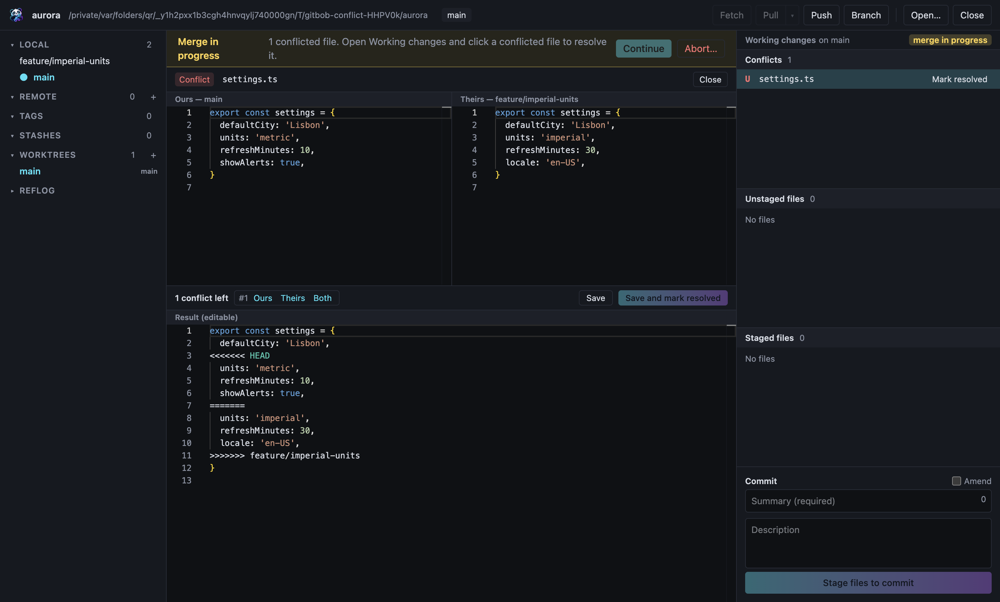
</p>

<br>

## Features

Every screenshot in this README is the real app working on a real Git repository, captured automatically by `npm run screenshots`.

<table>
  <tr>
    <td width="50%" valign="top">
      
      <h3>A graph you can actually read</h3>
      All local branches, remote branches, tags and HEAD in one view, newest first. Lanes keep their colors, merges curve in clearly, and only the rows on screen are drawn, so long histories stay smooth while more history loads as you scroll.
      <br><br>
      Commit details show the full message, author and committer, parents (click to jump) and every changed file with added and removed line counts.
    </td>
    <td width="50%" valign="top">
      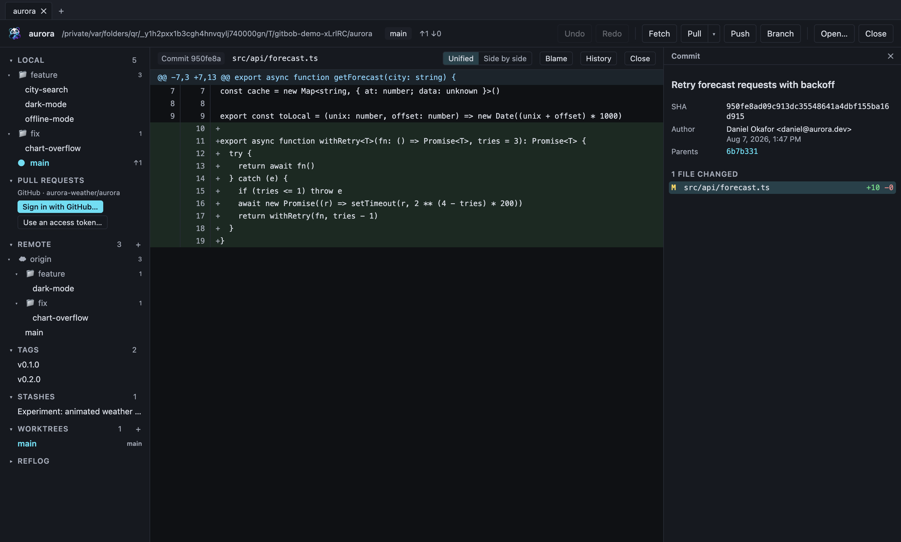
      <h3>Diffs for everything</h3>
      See changes for unstaged files, staged files, brand-new files, and any file in any commit. Line numbers on both sides, renames and binary files recognized, huge files truncated safely instead of freezing the app.
    </td>
  </tr>
  <tr>
    <td width="50%" valign="top">
      
      <h3>Staging and committing</h3>
      Stage and unstage single files or everything at once, also in brand-new repositories without any commits. Commit with a summary and description, or amend the previous commit with its message filled in. Hook failures and "nothing to commit" are reported clearly.
      <br><br>
      Edits made in your editor or terminal show up automatically.
    </td>
    <td width="50%" valign="top">
      
      <h3>Branches and remotes</h3>
      Create, switch, rename and delete branches, track remote branches, and see ahead/behind counts. Add and remove remotes. Fetch (with pruning), pull (fast-forward, merge or rebase) and push with clear explanations when the server rejects something, for example "Pull first" instead of a wall of Git output.
    </td>
  </tr>
  <tr>
    <td width="50%" valign="top">
      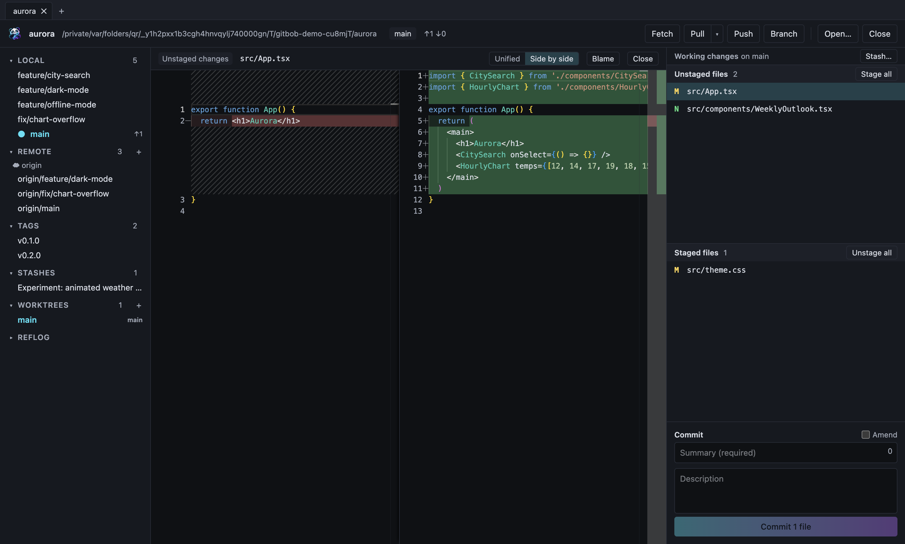
      <h3>Side by side, line by line</h3>
      A two-column diff with syntax highlighting for about 80 languages, powered by the same editor as VS Code. In the unified view, stage, unstage or discard single hunks or hand-picked lines.
    </td>
    <td width="50%" valign="top">
      
      <h3>Conflicts without fear</h3>
      Ours and theirs side by side, an editable result below, one click per conflict. GitBob refuses to mark a file resolved while conflict markers remain.
    </td>
  </tr>
  <tr>
    <td width="50%" valign="top">
      
      <h3>Rewrite history safely</h3>
      Interactive rebase without a text editor: reorder, reword, squash, fixup or drop commits in a dialog. If a conflict stops it, the banner takes you through Continue or Abort. The reflog keeps every former state one right-click away.
    </td>
    <td width="50%" valign="top">
      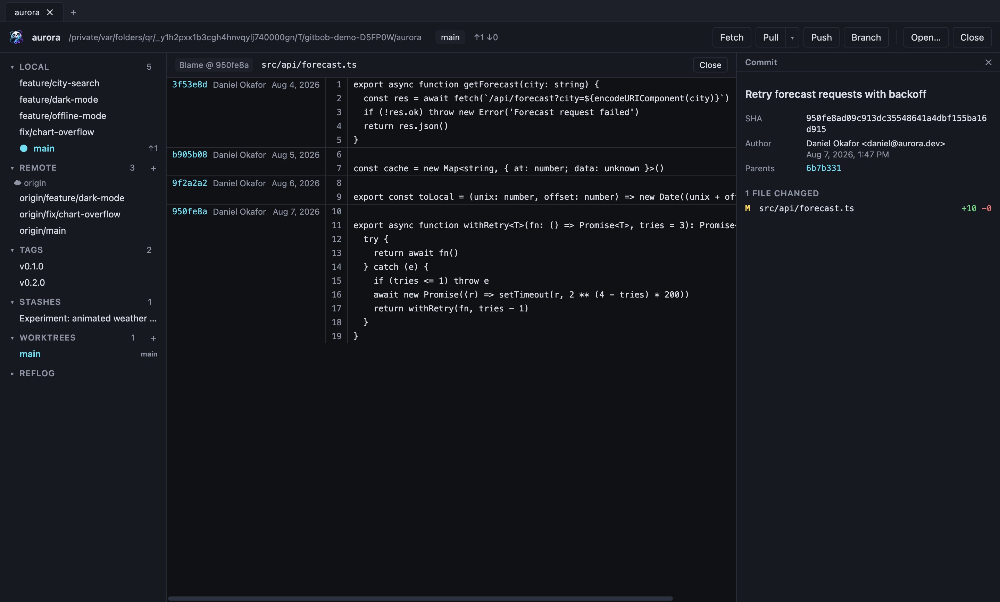
      <h3>Know the why behind every line</h3>
      Blame any file in your working tree or in any commit. Each block shows the commit, author and date; one click jumps to the commit in the graph.
    </td>
  </tr>
  <tr>
    <td width="50%" valign="top">
      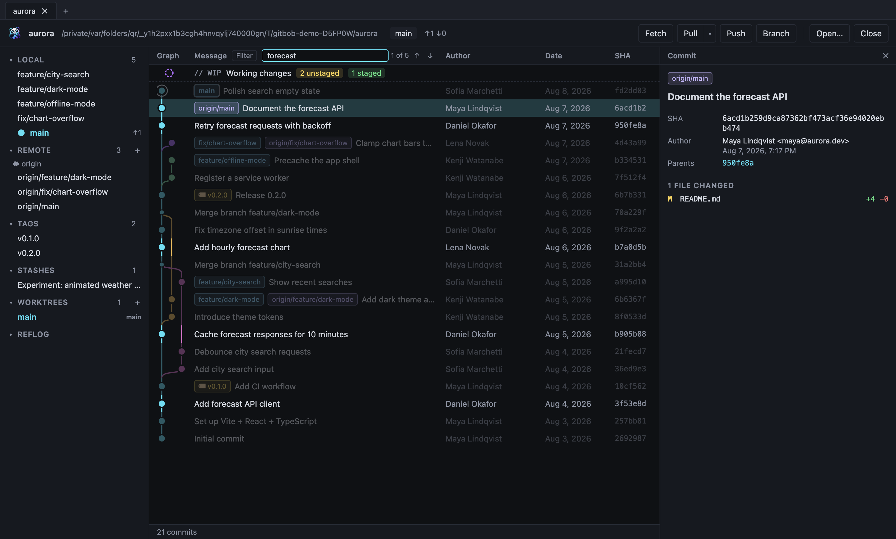
      <h3>Find anything</h3>
      <kbd>⌘F</kbd> searches the whole history (not just what's on screen) by message, author, committer or commit id. Matches light up, everything else fades, and <kbd>Enter</kbd> jumps to the next one, loading older history when needed.
    </td>
    <td width="50%" valign="top">
      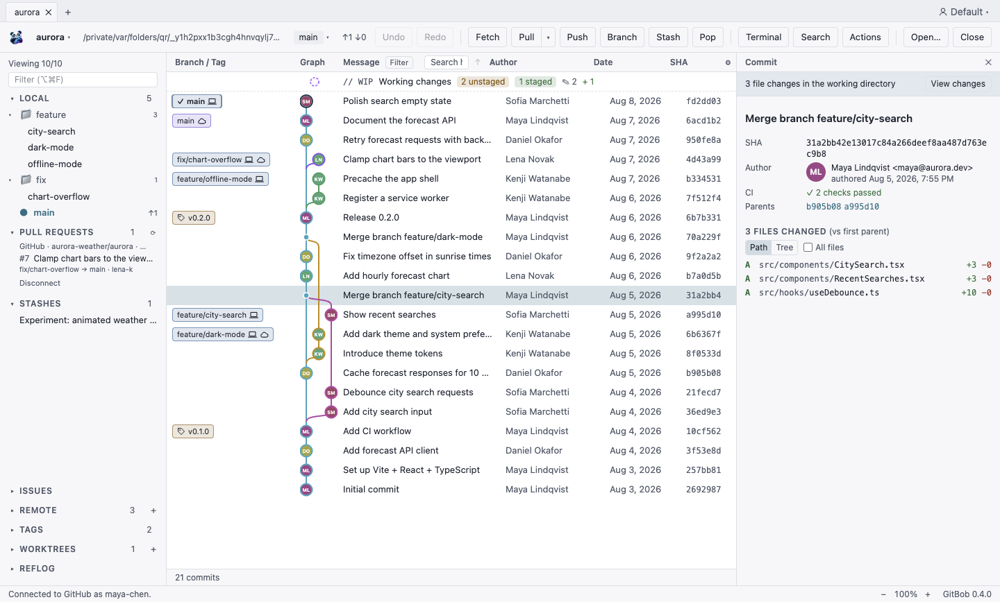
      <h3>Light or dark</h3>
      Pick Light, Dark or Match System under View → Theme. Graph colors, diffs and labels are tuned for both.
    </td>
  </tr>
</table>

<br>

## Everything in the box

<table>
  <tr>
    <td width="33%" valign="top">
      <h4>📜 History</h4>
      Commit graph across all branches, remotes and tags · filters by branch, author and path · merge and octopus-merge lanes · branch/tag/HEAD labels · commit details · whole-history search by message, author or id · keyboard navigation · incremental loading
    </td>
    <td width="33%" valign="top">
      <h4>🧩 Working tree</h4>
      Status with added, modified, deleted, renamed, untracked and conflicted files · stage/unstage files, hunks or single lines · discard with confirmation (new files go to the Trash) · unified and side-by-side diffs with syntax highlighting · three-way conflict editor · edit files in place · commit templates, drafts, Conventional Commits and co-author helpers · keep-ours/theirs for binary and delete conflicts · staged renames shown as renames · commit · amend · merge/rebase/cherry-pick in progress indicator · live refresh
    </td>
    <td width="33%" valign="top">
      <h4>🌿 Branches &amp; sync</h4>
      Branch folders · drag and drop to merge, rebase or cherry-pick · merge (ff / no-ff / ff-only) · rebase onto · create · checkout (local, remote-tracking, detached) · rename · delete (with unmerged protection) · upstream and ahead/behind · remotes add/remove · fetch with prune · pull ff-only/merge/rebase · push with upstream · force-with-lease · HTTPS credential prompt (optionally remembered in the OS keychain) · SSH passphrase and host-key prompts · progress and cancel
    </td>
  </tr>
  <tr>
    <td width="33%" valign="top">
      <h4>⏪ Undo &amp; rewrite</h4>
      Undo / redo for commits, checkouts, branches, tags, resets, cherry-picks, reverts, pulls and rebases · interactive rebase (reorder, reword, squash, fixup, drop) · cherry-pick · revert (merge commits too) · reset soft/mixed/hard with automatic backup · reflog · continue/skip/abort for stopped merges, rebases, cherry-picks and reverts
    </td>
    <td width="33%" valign="top">
      <h4>📦 Stash, tags &amp; LFS</h4>
      Stash with message (untracked files included) · stash a single file · pop · apply · apply one file · stash to branch · delete · see stashed files · annotated and lightweight tags · push and delete tags · Git LFS: tracked patterns, track/untrack, download missing files, set up per repository
    </td>
    <td width="33%" valign="top">
      <h4>🔗 Hosting services</h4>
      GitHub, GitLab, Bitbucket and Azure DevOps via personal access tokens (stored encrypted by the OS) · Sign in with GitHub (device flow) · clone from a searchable list of your repositories on every connected service · pull requests: list, view, files, line comments, comment, approve / request changes, merge / squash / rebase · CI status per commit · create pull requests, also as drafts
    </td>
  </tr>
  <tr>
    <td width="33%" valign="top">
      <h4>🎨 Comfortable</h4>
      Command palette · rebindable shortcuts · settings · accessible dialogs and contrast (checked with axe-core) · repository tabs (restored on restart) · clone with progress · new repository · light, dark or match-system theme · blame · file history · worktrees · submodules · GPG/SSH signature status · native menus · keyboard navigation · recent repositories · first-run setup (Git check, name and email) · in-app updates on Windows and Linux AppImage
    </td>
  </tr>
</table>

### On the roadmap

Sign-in with OAuth for GitLab, Bitbucket and Azure DevOps, and installers signed with developer certificates (which also brings automatic updates to macOS).

<br>

## Keyboard shortcuts

| Action | macOS | Windows / Linux |
|---|---|---|
| Open repository | <kbd>⌘O</kbd> | <kbd>Ctrl+O</kbd> |
| Clone repository | <kbd>⇧⌘O</kbd> | <kbd>Ctrl+Shift+O</kbd> |
| New repository | <kbd>⌥⌘N</kbd> | <kbd>Ctrl+Alt+N</kbd> |
| Command palette (run anything, switch branches) | <kbd>⌘K</kbd> | <kbd>Ctrl+K</kbd> |
| Settings | <kbd>⌘,</kbd> | <kbd>Ctrl+,</kbd> |
| Search history | <kbd>⌘F</kbd> | <kbd>Ctrl+F</kbd> |
| Fetch / Pull / Push | <kbd>⇧⌘F</kbd> / <kbd>⇧⌘L</kbd> / <kbd>⇧⌘P</kbd> | <kbd>Ctrl+Shift+F</kbd> / <kbd>L</kbd> / <kbd>P</kbd> |
| New branch | <kbd>⌘B</kbd> | <kbd>Ctrl+B</kbd> |
| Stash changes | <kbd>⇧⌘S</kbd> | <kbd>Ctrl+Shift+S</kbd> |
| Working changes | <kbd>⇧⌘C</kbd> | <kbd>Ctrl+Shift+C</kbd> |
| New tab / close tab | <kbd>⌘T</kbd> / <kbd>⇧⌘W</kbd> | <kbd>Ctrl+T</kbd> / <kbd>Ctrl+Shift+W</kbd> |
| Next / previous match | <kbd>Enter</kbd> / <kbd>⇧Enter</kbd> | <kbd>Enter</kbd> / <kbd>Shift+Enter</kbd> |
| Move through commits | <kbd>↑</kbd> <kbd>↓</kbd> | <kbd>↑</kbd> <kbd>↓</kbd> |
| Commit | <kbd>⌘Enter</kbd> in the message box | <kbd>Ctrl+Enter</kbd> |
| Close a dialog / clear search | <kbd>Esc</kbd> | <kbd>Esc</kbd> |

Every shortcut can be changed in **Settings → Keyboard shortcuts**. Don't remember a shortcut? Press <kbd>⌘K</kbd> and type what you want to do.

<br>

## FAQ

**Is it really free?** Yes. GitBob costs nothing, needs no account, and its source code is MIT licensed.

**Does it replace Git?** No. GitBob uses the Git already installed on your computer for every operation, so your repositories stay 100% standard. You can switch between GitBob, your terminal and other tools at any time.

**Will it mess up my repository?** GitBob only does what you ask, through Git itself. Anything that can lose work asks for confirmation first (made by the app itself, so nothing can skip it), and discarded new files go to the Trash.

**Where are my passwords stored?** Never in a file by GitBob. When Git asks for credentials, GitBob shows a dialog and passes your answer to Git. If you tick *Remember*, they go to your system's secure credential store (macOS Keychain, Windows Credential Manager, or libsecret on Linux) through Git's own credential helpers. Access tokens for GitHub and the like are encrypted with your operating system's keychain.

**Does it send data anywhere?** No telemetry, no analytics. The only network traffic is Git talking to your remotes, the hosting service you connect yourself, and, only if you ask for it in Settings, a check of GitHub Releases for a newer GitBob.

**Windows and Linux?** Yes. Every change is tested automatically on macOS, Windows and Linux (the full end-to-end suite runs on macOS and Linux), and each release ships installers for all three.

<br>

## For developers

GitBob is an Electron app written in TypeScript with React. Git operations run in the main process through the installed `git` binary (argument arrays, never a shell); the sandboxed UI talks to it through a small, validated IPC API.

```sh
npm run dev          # run with hot reload
npm run check        # typecheck + lint + unit/integration tests
npm run test:e2e     # build and run end-to-end tests that drive the real app
npm run screenshots  # regenerate the README screenshots
npm run dist:mac     # package for macOS (dmg + zip)
```

- **Fast on big repositories:** measured on a generated 100,000-commit repository: the full history loads in about 3 seconds and the graph layout takes about 40 ms ([`docs/BENCHMARKS.md`](docs/BENCHMARKS.md)).
- **Tested against real Git:** more than 600 integration tests (including fake GitHub, GitLab, Bitbucket and Azure DevOps API servers) (including randomized partial-staging checks) create throwaway repositories (including local "servers" and an authenticated HTTP Git server) and check the results with Git itself; Playwright end-to-end tests click through the actual app.
- **Accessible:** an axe-core audit of the main screens in both themes runs with the end-to-end tests and must report no serious issues.
- **Secure by default:** sandboxed renderer without Node access, context isolation, strict Content Security Policy, schema-validated IPC, and Git can only be run on repositories you opened.

<br>

## License

GitBob is released under the [MIT License](LICENSE).

<br>

<p align="center">
  <br>
  <b>GitBob</b> · <a href="https://gitbob.app/">gitbob.app</a><br>
  <sub>Made with care for everyone who uses Git.</sub>
</p>
